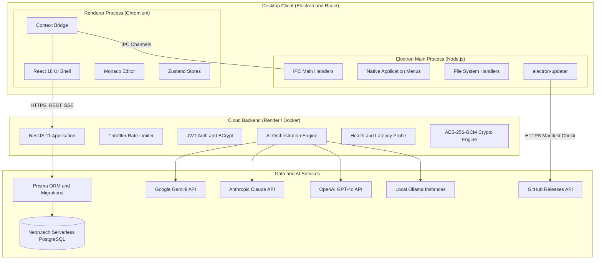
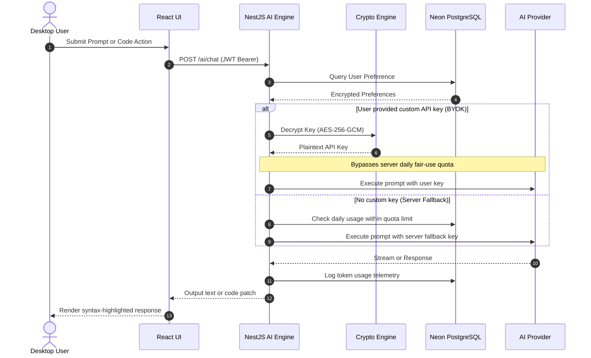
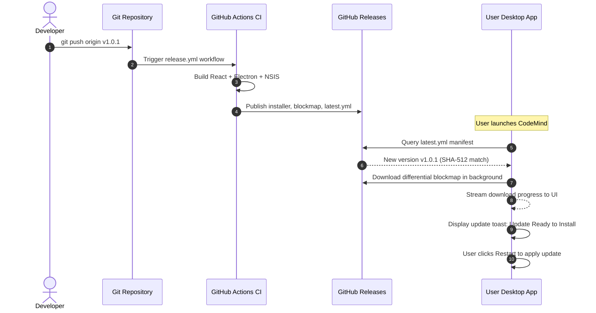
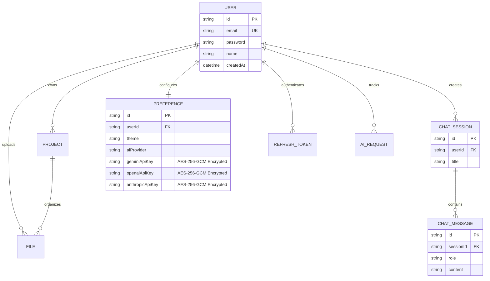

# 🏗️ CodeMind Architecture & System Specification

CodeMind is an AI-native developer desktop IDE designed for seamless pair programming, intelligent code generation, Monaco-powered editing, and persistent multi-modal AI chat sessions.

---

## 1. High-Level System Architecture



---

## 2. Monorepo Organization & Workspace Layout

CodeMind is organized as an npm workspace monorepo managed with Turborepo:

```
code-mind/
├── .agents/                      # AI Agent Skills & Customizations
│   └── skills/                   # Modular Agent Skills (release, ai-eval, backend-ops)
├── .github/                      # GitHub Workflows & CI/CD Pipelines
│   └── workflows/release.yml     # Automated desktop packaging & GitHub Release
├── backend/                      # Enterprise NestJS Backend Service
│   ├── prisma/                   # Prisma Schema & Database Migrations
│   │   ├── schema.prisma         # Data models (User, Preference, Session, Message)
│   │   └── migrations/           # Versioned SQL migration history
│   ├── src/
│   │   ├── ai/                   # Multi-provider LLM orchestrator & BYOK resolvers
│   │   ├── auth/                 # JWT authentication, guards, and refresh strategy
│   │   ├── common/               # AES-256-GCM encryption & rate limiters
│   │   ├── health/               # Dynamic database latency probe
│   │   ├── projects/             # Cloud-synced project records
│   │   ├── users/                # User profile & encrypted preferences
│   │   └── main.ts               # Express bootstrapping & Dynamic CORS
│   └── Dockerfile                # Multi-stage production container
├── desktop/
│   ├── electron/                 # Electron Desktop Native Shell
│   │   ├── main.ts               # Main process window lifecycle & security
│   │   ├── preload.ts            # Context isolation bridge
│   │   ├── ipcHandlers.ts        # Secure file system access
│   │   ├── updater.ts            # electron-updater event streaming
│   │   └── electron-builder.yml  # Packaging & GitHub Releases target
│   └── react/                    # Modern React 18 User Interface
│       ├── src/
│       │   ├── components/       # UI Components (Editor, AI Panel, Settings, Sidebar)
│       │   ├── stores/           # Zustand reactive state stores
│       │   ├── utils/            # API client with typed exception parsing
│       │   └── types/            # TypeScript domain interfaces & CodemindApi
│       └── vite.config.ts        # Rolldown/Vite bundler targeting electron/renderer
├── shared/                       # Shared contracts, DTOs, and types
├── scripts/                      # Setup scripts and cryptographic key generators
├── AGENTS.md                     # AI Agent System Instructions & Guidelines
├── README.md                     # Project overview and local quickstart
└── RELEASE.md                    # Production release and deployment documentation
```

---

## 3. Core Subsystems

### 3.1 Security & Shell Sandbox Model
- **Context Isolation**: Electron renderer has `nodeIntegration: false` and `contextIsolation: true`. All native interactions (`fs:readFile`, `fs:writeFile`, `app:getVersion`, `updater:*`) must pass through the typed preload bridge.
- **External URL Hardening**: External links in webview or windows are intercepted via `setWindowOpenHandler` and opened in the user's default OS browser, blocking renderer window takeovers.
- **Dynamic CORS**: The backend evaluates origins dynamically. In production, desktop origins (`app://`, `file://`) and configured domains are allowed, while unauthorized web origins are rejected.
- **Rate Limiting**: NestJS `@nestjs/throttler` applies multi-tier rate limiting:
  - Global routes: 120 requests / min
  - Auth routes: 15 requests / min
  - AI endpoints: 30 requests / min

---

### 3.2 Multi-Provider AI Engine & BYOK Architecture
The AI subsystem (`backend/src/ai/ai.service.ts`) supports dynamic routing across 4 providers:



#### Key Capabilities:
1. **Zero-Friction Access**: If `GEMINI_API_KEY` is configured in Render environment variables, users can chat immediately without entering an API key.
2. **Encrypted BYOK**: Users can paste personal keys in Settings. Keys are encrypted via `crypto.util.ts` with AES-256-GCM using `SETTINGS_ENCRYPTION_KEY` before persistence, preventing plaintext leaks even to database administrators.
3. **Graceful Fallbacks**: If a provider fails or encounters upstream rate limits, the orchestrator cascades down the configured priority chain (Gemini &rarr; Claude &rarr; OpenAI &rarr; Ollama).

---

### 3.3 Production Auto-Update Lifecycle
CodeMind utilizes differential blockmap updates powered by GitHub Releases and `electron-updater`:



---

## 4. Database Schema (Prisma)

The persistence layer runs on serverless PostgreSQL (Neon.tech) with connection pooling enabled:


